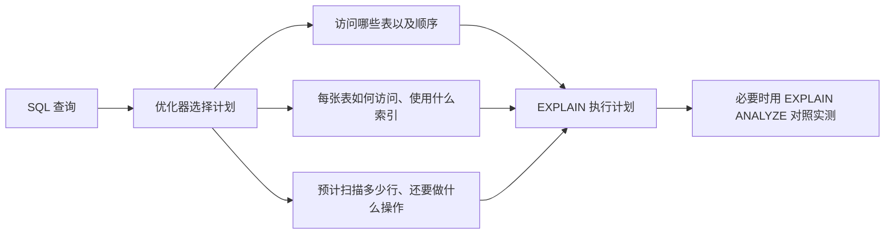
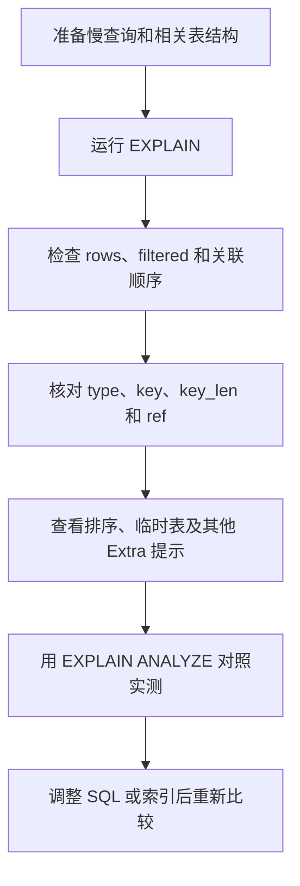

# MySQL EXPLAIN 执行计划详解

一条 SQL 执行得慢，光看 SQL 文本通常很难判断原因：是没有选中合适的索引、扫描了太多行，还是排序和关联方式带来了额外工作？

MySQL 的 `EXPLAIN` 会展示优化器为语句选择的执行计划。读懂它，我们就能从“猜哪里慢”转向检查数据库准备怎么访问表、使用什么索引，以及预计要处理多少数据。

本文以 **MySQL 8.4 的 `FORMAT=TRADITIONAL` 表格格式**为主。其他版本可能增减取值；`FORMAT=JSON` 和 `FORMAT=TREE` 的结构也不同。下文的字段定义和 `Extra` 速查以这个版本范围为准。

## 先看懂 EXPLAIN 展示的是什么

`EXPLAIN` 展示的是优化器选择的**计划和估算**，不是 SQL 实际执行后的耗时报告。对于 `SELECT`，表格结果通常每行代表一个被访问的表；输出顺序反映 MySQL 计划读取这些表的顺序。关联查询中，前面表的结果会影响后续表的访问次数。



最简单的用法是把 `EXPLAIN` 放在查询前面：

```sql
EXPLAIN FORMAT=TRADITIONAL
SELECT * FROM orders WHERE user_id = 100;
```

排查时不必从左到右逐列背诵。先找预计工作量大的步骤，再看访问方式、索引和额外操作，通常更容易定位问题。

## 按排查顺序读执行计划

### 1. 先找预计处理行数较大的步骤：`rows` 和 `filtered`

`rows` 是优化器估计执行这个步骤需要检查的行数，不是查询最终返回的行数，也不是实测值。对 InnoDB 表来说，它是估算，可能与实际情况不同。

`filtered` 是经过当前表条件过滤后，预计还能传给后续步骤的行数比例。例如 `rows=1000`、`filtered=10.00`，表示预计检查约 1000 行，过滤后约有 100 行进入后续步骤：

```text
1000 × 10% ≈ 100 行
```

关联查询中，后续表可能针对前面产生的每种行组合再次访问。因此，不要只盯着某个孤立的 `rows` 数字，还要结合表的访问顺序和后续访问方式判断总工作量。

### 2. 看访问方式：`type`

`type` 描述当前表的访问或关联方式，不是表的数据类型。MySQL 8.4 文档按大致从优到劣的顺序列出这些类型；这是排查线索，不是脱离数据量后仍然成立的绝对性能排名。

| `type` | 大意 | 阅读提示 |
| --- | --- | --- |
| `system` | 表只有一行，是 `const` 的特例 | 很少见 |
| `const` | 用主键或唯一索引匹配常量，最多一行 | 通常只读取一次 |
| `eq_ref` | 对前面表的每种行组合，通过主键或非空唯一索引最多匹配一行 | 常见于唯一键关联 |
| `ref` | 通过索引等值查找，可能匹配多行 | 普通索引等值查询常见 |
| `fulltext` | 使用全文索引 | 结合全文查询判断 |
| `ref_or_null` | 按索引查找，并额外查找索引列为 `NULL` 的行 | 常见于带 `OR ... IS NULL` 的条件 |
| `index_merge` | 合并多个索引的扫描结果 | 查看 `key` 和 `Extra` 中的合并方式 |
| `unique_subquery` | 某些 `IN (SELECT 主键 ...)` 子查询转换成唯一索引查找 | 子查询优化方式之一 |
| `index_subquery` | 类似 `unique_subquery`，但使用非唯一索引 | 子查询优化方式之一 |
| `range` | 用索引读取指定范围 | 例如区间、部分 `IN` 或 `LIKE` 条件 |
| `index` | 扫描整个索引树 | 可能是覆盖索引，也可能仍需读取数据行 |
| `ALL` | 全表扫描 | 大表或关联中的后续表尤其值得检查 |

出现 `ALL` 不代表一定有问题：小表全表扫描可能比走索引更划算。`index` 也不表示只读取少量索引项，它可能扫描整个索引。最终要把 `type` 和 `rows`、表大小、查询频率及关联位置放在一起看。

### 3. 核对索引选择：`key`、`possible_keys`、`key_len` 和 `ref`

| 字段 | 含义 | 怎么用 |
| --- | --- | --- |
| `key` | 优化器实际选中的索引 | 看它是否符合预期；`NULL` 表示没有选中索引 |
| `possible_keys` | 优化器认为可能用于定位行的候选索引 | 有候选索引不代表最后一定使用 |
| `key_len` | 实际使用的索引键长度 | 可辅助判断联合索引用到了哪些部分 |
| `ref` | 用什么值与索引比较 | 可能是常量、前面表的列，或表达式 |

`key` 有时不在 `possible_keys` 中：候选索引可能不适合用于定位行，但另一个索引覆盖了查询所需的列。此时优化器可能选择扫描该索引，而不是扫描数据行。

`key_len` 以长度表示索引键的使用情况，不等于使用了几个字段。列类型、字符集和是否允许 `NULL` 等都会影响长度；查看联合索引时，应结合索引定义和查询条件判断。

`ref` 为 `const` 时，通常表示拿常量与索引比较；显示列名时，可能是拿前面表的某列做关联；显示 `func` 时，比较值来自函数或表达式。

### 4. 检查额外操作：`Extra`

`Extra` 可以包含多种提示。初次排查时，建议优先关注排序、临时表、索引覆盖和条件下推：

| 常见值 | 含义 | 注意点 |
| --- | --- | --- |
| `Using where` | 读取后还要根据条件过滤 | 不代表没有使用索引 |
| `Using index` | 查询需要的列可以从索引中取得，通常称为覆盖索引 | 与 `type=index` 不是一回事 |
| `Using index condition` | 使用索引条件下推，先在索引项上检查部分条件 | 可能减少读取完整数据行的次数 |
| `Using filesort` | 需要额外排序 | 名字不表示一定写入磁盘 |
| `Using temporary` | 使用临时表保存中间结果 | 结合分组、排序和数据量检查 |
| `Using index for group-by` | 借助索引处理 `GROUP BY` 或 `DISTINCT` | 某些情况下每组只需读取少量索引项 |
| `Using index for skip scan` | 使用索引跳跃扫描 | 结合索引结构与查询条件理解 |
| `Backward index scan` | 对 InnoDB 索引做反向扫描 | 常与 `Using index` 一起出现 |
| `Using MRR` | 使用 Multi-Range Read 组织多范围对应的数据行读取 | 一种读取优化方式 |

`Using filesort` 和 `Using temporary` 值得留意，但不应只看见它们就立刻加索引。先检查排序或分组是否必要、数据规模多大，再结合实际执行情况决定是否优化。

### 5. 最后看查询块与表信息：`id`、`select_type`、`table`、`partitions`

这些字段帮助解释执行计划中的每一行属于什么查询、处理哪个对象：

| 字段 | 含义 | 注意点 |
| --- | --- | --- |
| `table` | 当前行处理的表或中间结果 | 也可能显示 `<derivedN>`、`<subqueryN>` 或 `<unionM,N>` |
| `id` | 查询块编号 | 同一 `id` 可对应多行；不要只按编号大小推断完整执行顺序 |
| `select_type` | 查询块类型 | 可识别主查询、子查询、派生表和 `UNION` 等 |
| `partitions` | 计划可能访问的分区 | 非分区表为 `NULL`，可用于检查分区裁剪 |

常见的 `select_type` 包括：

| 值 | 含义 |
| --- | --- |
| `SIMPLE` | 简单查询，不包含 `UNION` 或子查询 |
| `PRIMARY` | 最外层查询 |
| `UNION` | `UNION` 中第二个及之后的查询块 |
| `DEPENDENT UNION` | 依赖外层查询的 `UNION` 部分 |
| `UNION RESULT` | `UNION` 的结果 |
| `SUBQUERY` | 子查询中的第一个查询块 |
| `DEPENDENT SUBQUERY` | 依赖外层查询的子查询，通常是相关子查询 |
| `DERIVED` | 派生表 |
| `DEPENDENT DERIVED` | 依赖其他表的派生表 |
| `MATERIALIZED` | 物化后的子查询 |
| `UNCACHEABLE SUBQUERY` | 结果无法缓存，需针对外层行重新求值的子查询 |
| `UNCACHEABLE UNION` | 不可缓存子查询中后续的 `UNION` 部分 |

## 从估算走向实测：`EXPLAIN ANALYZE`

如果 `rows` 的估算和实际表现不一致，可以进一步使用 `EXPLAIN ANALYZE`：

```sql
EXPLAIN ANALYZE
SELECT * FROM orders WHERE user_id = 100;
```

它会实际执行查询，并在 `TREE` 格式中显示估算与观测到的行数、循环次数和耗时。对 `SELECT` 来说，这有助于发现估算偏差和真正耗时的步骤。

要注意，`EXPLAIN ANALYZE` 不是只生成计划。MySQL 8.4 也支持对特定多表 `UPDATE` 和 `DELETE` 使用它，而这些语句会实际执行并可能修改数据；对有副作用的语句，先在安全环境中评估再运行。`EXPLAIN ANALYZE` 始终使用 `TREE` 格式，不支持 `TRADITIONAL` 或 `JSON` 格式。

## 一次实际排查可以怎么做



可以按这个顺序检查：

1. 从 `rows` 较大的步骤开始，结合关联顺序判断它可能被访问多少次。
2. 看 `type` 和 `key`，确认访问方式与索引是否合理。
3. 看 `key_len` 和 `ref`，判断联合索引使用部分及关联条件。
4. 检查 `Extra` 中的排序、临时表、索引条件下推和连接策略。
5. 用 `EXPLAIN ANALYZE` 对比估算值和实际行数、耗时。
6. 每次调整 SQL 或索引后重新观察计划，并用有代表性的数据验证。

执行计划是定位问题的证据之一，不能代替基准测试。数据分布、统计信息、并发负载和缓存状态都会影响实际体验。

## `Extra` 进阶速查

下面整理了 MySQL 8.4 文档中较少见或依赖特定语句、查询形态和存储引擎的取值。常规排查不必先记住它们，遇到时再按类别查阅。

### 索引合并、连接与分组

| 值 | 含义 |
| --- | --- |
| `Using sort_union(...)` | `index_merge` 使用排序后求并集 |
| `Using union(...)` | `index_merge` 使用求并集 |
| `Using intersect(...)` | `index_merge` 使用求交集 |
| `Using join buffer (Block Nested Loop)` | 使用连接缓冲区执行 Block Nested Loop |
| `Using join buffer (Batched Key Access)` | 使用连接缓冲区执行 Batched Key Access |
| `Using join buffer (hash join)` | 使用连接缓冲区执行哈希连接 |
| `Range checked for each record (index map: N)` | 前面表的值确定后，才逐次检查当前表能否使用范围访问或索引合并；`N` 是索引映射信息 |

### 子查询、关联与中间结果

| 值 | 含义 |
| --- | --- |
| `Distinct` | 当前行组合找到第一个匹配值后，不再继续查找重复值 |
| `FirstMatch(表名)` | 半连接使用 FirstMatch 策略，找到首个匹配后提前停止 |
| `LooseScan(m..n)` | 半连接使用 LooseScan 策略；`m..n` 表示索引部分编号 |
| `Start temporary` / `End temporary` | 半连接的 Duplicate Weedout 策略使用临时表 |
| `Not exists` | 对不存在性判断使用提前停止优化；可见于特定 `LEFT JOIN ... IS NULL` 或反连接计划 |
| `Full scan on NULL key` | 子查询索引查找不可用时，使用全扫描作为后备策略 |
| `Rematerialize (X,...)` | 前面表每读入新行，就重新物化相关的横向派生表 `X` |
| `Recursive` | 当前行对应递归 CTE 的递归部分 |

### 没有匹配行或无需常规扫描

| 值 | 含义 |
| --- | --- |
| `Impossible WHERE` | `WHERE` 条件恒为假 |
| `Impossible WHERE noticed after reading const tables` | 读取 `const` 或 `system` 表后，发现 `WHERE` 条件恒为假 |
| `Impossible HAVING` | `HAVING` 条件恒为假 |
| `Zero limit` | 查询含 `LIMIT 0`，不会返回行 |
| `const row not found` | 要读取的表为空 |
| `unique row not found` | 主键或唯一索引条件没有找到行 |
| `no matching row in const table` | 作为常量表访问的关联表没有匹配行 |
| `No matching min/max row` | `MIN()` 或 `MAX()` 查询没有满足条件的行 |
| `No matching rows after partition pruning` | `UPDATE` 或 `DELETE` 经分区裁剪后没有可处理的行 |
| `No tables used` | 查询没有 `FROM` 表或使用 `FROM DUAL`；某些不带 `SELECT` 部分的 `INSERT` 或 `REPLACE` 也会出现 |
| `Select tables optimized away` | 优化阶段已能确定聚合结果，执行阶段无需再扫描表 |

### 特定语句、存储引擎或系统表

| 值 | 含义 |
| --- | --- |
| `Deleting all rows` | 某些存储引擎对删除全表行使用快速处理方式 |
| `Plan isn't ready yet` | `EXPLAIN FOR CONNECTION` 查看语句时，完整计划尚未生成 |
| `Child of '表名' pushed join@1` | NDB Cluster 中，该表是可下推到 NDB 内核的连接子表 |
| `Using where with pushed condition` | NDB Cluster 将过滤条件下推到数据节点 |
| `Scanned N databases` | 查询 `INFORMATION_SCHEMA` 时扫描的数据库目录数；`N` 可为 `0`、`1` 或 `all` |
| `Skip_open_table` | 查询 `INFORMATION_SCHEMA` 时无需打开表文件 |
| `Open_frm_only` | 查询 `INFORMATION_SCHEMA` 时只需读取数据字典信息 |
| `Open_full_table` | 查询 `INFORMATION_SCHEMA` 时还需读取表文件 |

## 常见误区

- **把 `rows` 当成最终返回行数。** 它是优化器对该步骤需要检查行数的估算。
- **认为 `ALL` 必然很差。** 小表全扫可能更合适；大表和关联中的后续表出现全扫时更值得调查。
- **认为 `type=index` 就是少量索引查找。** 它可能扫描整个索引。
- **认为 `Using where` 代表没有用索引。** 它只说明还需要根据条件过滤。
- **认为 `Using filesort` 就一定落盘。** 这个名字表示额外排序操作，不说明排序一定使用磁盘。
- **认为有 `possible_keys` 就一定会使用索引。** 实际选择要看 `key`。
- **把 `EXPLAIN` 的估算当作实际执行数据。** 需要测量时使用 `EXPLAIN ANALYZE`，并记得它会执行语句。

## 记住这条阅读主线

读 MySQL `EXPLAIN`，先看每个步骤预计要处理多少数据，再看数据库如何访问这些数据、选了什么索引，最后检查排序、临时表等额外工作。估算值得怀疑时，用 `EXPLAIN ANALYZE` 对照实际行数和耗时。

不需要把所有字段和 `Extra` 取值都背下来。能按“工作量 → 访问方式 → 索引 → 额外操作 → 实际执行”这条主线提出正确的问题，就已经能处理大多数慢查询排查场景。

## 参考资料

- [MySQL 8.4 Reference Manual：EXPLAIN Output Format](https://dev.mysql.com/doc/refman/8.4/en/explain-output.html)
- [MySQL 8.4 Reference Manual：EXPLAIN Statement](https://dev.mysql.com/doc/refman/8.4/en/explain.html)
